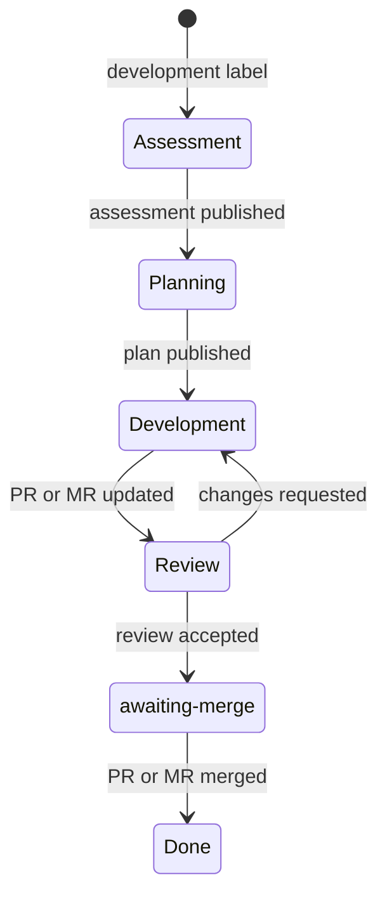
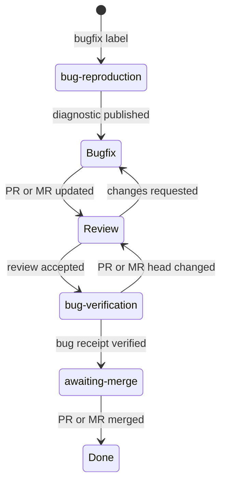
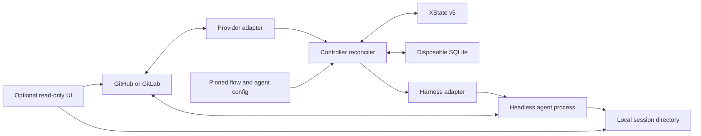

# Agent flow controller architecture

Status: Accepted and implemented for provider recovery and local SQLite execution.

This document records the agreed target architecture for a controller that partially automates development work from
GitHub or GitLab tickets.

The prototype's executable YAML and JSON contracts are defined in
[`prototype-contracts.md`](prototype-contracts.md) and `schemas/v1/`.

## Purpose

The controller moves a ticket through architectural assessment, planning, development, review, rework, and merge. A
different headless agent may handle each stage. Humans may approve intermediate results or answer questions, depending
on the configured flow policy.

The controller coordinates the work. Agents remain responsible for their domain work and publish their own final
results. GitHub or GitLab is the source of truth for every operational decision.

The decision is recorded in [ADR 0001](adr/0001-provider-commit-points-and-local-execution.md).
[Recovery rules](recovery-from-provider-draft.md) define failure cases; the
[data model](recovery-data-model.md) defines publication metadata, local identity, and SQLite.
The [recovery specification](recovery-from-provider-draft.md) defines restart, ownership, and ambiguity handling.

## Agreed invariants

### Source of truth

- GitHub or GitLab is the commit point for published work and stage transitions.
- SQLite stores disposable execution state. Losing it can reset retry counts and repeat unpublished work.
- Recover from activation and stage labels, published results, human answers, and linked PR/MR evidence. Ambiguous
  evidence pauses the affected ticket for clarification; unattended recovery is not guaranteed in every case.
- Agents publish substantive results with a hidden block containing configuration SHA and controller UUID. There is
  no separate mutable control comment and no controller-assignment label.
- Local workspaces and sessions contain replaceable execution artifacts. Preserve published code and inspect existing
  PRs/MRs before retrying work. A published object alone does not prove completion.
- Exactly one `agent-stage:*` label records the stage. Both merge-wait states use `agent-stage:awaiting-merge`;
  the pinned activation route disambiguates their internal states. The flow and provider evidence reconcile interrupted
  publication/label updates. Cached SQLite state cannot override provider cancellation or ownership.
- The first eligible publication of identifiable current work determines its owner. Accidental overlap can produce
  duplicate work before the next reconciliation; this is accepted rather than prevented by distributed locking.

### Flow versioning

- Flow and agent configuration lives in one Git repository.
- A new flow instance pins the configuration repository commit SHA that was current when the instance started.
- The controller accepts an absolute local repository path or a credential-free `https://` or `file://` Git URL. For
  a URL, it clones or fetches one bare mirror under the data directory during startup.
- A controller process prepares that mirror once. Reconciliation reads only the prepared repository, so remote changes
  become available after a service restart and never move an active flow implicitly.
- Each materialized revision retains a minimal Git object store. The controller verifies its files against the pinned
  commit before loading them, even when a later history rewrite and garbage collection remove the commit from the
  startup mirror.
- The controller includes that SHA in each substantive agent publication. With no published pin, recovery can use
  current configuration; with an unavailable or conflicting pin, it must pause.
- The pinned configuration revision includes every `apm.lock.yaml` produced for the agent catalog. External APM
  artifacts must resolve through a committed lockfile.
- Fetching a newer configuration revision must not change a running instance.
- A running instance changes its pinned revision only through an explicit migration.

### Activation and cancellation

- The exact `agent-flow:development` label starts the development branch. The exact `bugfix` label starts the bugfix
  branch directly; the controller does not infer or validate the ticket type.
- Only a provider user with `write` or `maintain` access may start or resume a flow.
- If more than one activation label is present, the latest matching label event selects the route. The accepted label
  is pinned with the flow instance, so another route's label event cannot authorize it and later startup-config changes
  cannot cancel an already-running instance.
- On the first accepted activation, the controller adds `agent-flow:managed`. This discovery label is permanent and
  remains after completion, cancellation, and later flow instances.
- When a flow reaches `done`, the controller removes every configured activation label and leaves `agent-flow:managed`
  and `agent-stage:done` on the ticket.
- Reapplying the activation label after a completed or cancelled run creates a new flow instance.
- Removing the activation label cancels the active agent process when the controller observes the removal and prevents
  new attempts from starting.
- Closing a ticket with an active flow also cancels the instance, stops the active agent process, and removes its
  configured activation labels. Reopening the ticket does not resume the cancelled instance; a new run requires an
  activation label to be applied again.
- If the same provider update contains a merged pull or merge request that completes a flow in `awaiting-merge`, the
  controller applies `done` rather than treating the resulting ticket closure as cancellation.
- An agent result that arrives after the controller observes cancellation must not advance the flow.
- Cancellation detection need not be instantaneous. The controller must act on the removal once periodic
  reconciliation observes it.
- The initial version discovers provider changes only through periodic reconciliation. It does not receive webhooks.
- Only repositories in an explicit allowlist may be processed.

### Concurrency and deployment

- Each installation has one supervised controller process and a persistent UUID outside SQLite. Independent
  installations normally use different repository allowlists and may use different flows on the same host.
- The controller may process different tickets in parallel.
- Within an installation, a per-ticket guard prevents overlapping agent processes. Across accidental overlapping
  installations, the first publication wins ownership and the loser stops on ordinary reconciliation.
- Each active flow instance has its own writable repository workspace. Concurrent tickets must never share a working
  tree.
- Each attempt starts a new headless agent process and creates a separate local session directory.
- A configurable global concurrency limit bounds parallel ticket processing.
- The deployment runs either as one Docker container or as one Kubernetes replica.
- Each Kubernetes installation uses a persistent volume and `Recreate`. Transfer its UUID and routing configuration
  only after stopping the previous executor and agents. A fresh installation cannot silently adopt foreign work.

### Agent configuration and harnesses

- The configuration repository contains an `agent-packages/` catalog of agent types and the flow definitions that
  refer to them.
- Each agent type has its own directory and exactly one `apm.yml` with one logical entry agent.
- The project authors its own agent packages around its established engineering practices. A prebuilt autonomous
  development package is not the foundation of the flow.
- An `apm.yml` may reference a specific external APM artifact when the local catalog does not provide the required
  capability. External artifacts are reused individually rather than importing another orchestration flow.
- APM lockfiles are committed to the configuration repository. Updating an external artifact requires a lockfile
  update and a new configuration commit.
- APM generates files for a named target harness. The selected target must match the harness that will execute the
  agent.
- Different agent types in the same deployment may use different harnesses. For example, an architect may use Claude
  while a developer uses Codex.
- Each harness must be installed and authenticated on the executor before work starts.
- Harness adapters own command construction, startup, cancellation, exit decoding, and agent-decision extraction.
- The initial adapters run Codex through `codex exec` and Claude through `claude -p` as ordinary headless CLI processes
  in the prepared working directory. A Pi adapter or another harness may be added later without changing flow
  semantics.

### Provider access and publication

- GitHub agents use an already authenticated `gh`; GitLab agents use an already authenticated `glab`.
- Agents initially run under the operator's user account and have direct provider access with `write` or `maintain`
  permissions.
- Legacy configuration pins use agent publication for stage outputs. New Stack pins may select
  `publication: controller-prepared-v1`: agents prepare substantive stage comment text locally, then the controller
  publishes it with the existing common marker and completed-attempt accounting in one create. Exact readback and
  normal provider evidence validation precede acceptance. Published comments are never edited for accounting.
  Pull or merge request changes and native reviews remain agent-published. Completed prepared delivery may retry
  independently of model execution; uncertain writes require provider reconciliation before any further write.
- Agent packages describe domain behavior only. They do not define flow events, state labels, publication markers,
  machine record fields, or the structured response contract.
- Before each attempt, the controller generates a runtime protocol prompt from the pinned flow state, attempt mode,
  result contract, and outgoing transitions. Harness adapters add this controller-owned prompt to the compiled APM
  instructions.
- The runtime prompt exposes only events that the model may choose in the current state. Provider and controller events,
  including merge observation, head changes, retry exhaustion, and blocked-state recovery, are never model options.
- The model writes one minimal JSON decision. It does not repeat deterministic state or provider facts such as the flow
  instance, attempt ID, target state, retry budget, artifact ID, URL, change-request state, or head SHA.
- The controller treats the model decision as untrusted input, reads the required provider artifact back, and builds the
  verified attempt result stored locally in SQLite. The state machine receives no event until both agree.
- The controller owns the reserved state labels. Agent instructions must prohibit editing them, and the controller must
  reject a transition that is not valid for the current flow state.
- Every agent-authored publication includes the controller-supplied block on creation:
  `<!-- agent-flow:v1 {"config":"<configuration-sha>","controller":"<controller-id>"} -->`.
  Human comments remain unmarked. The marker identifies format and installation, not authorization or success.
- The PR/MR description carries the same block when it can be the only publication. Review-specific head and verdict
  evidence remains separate. Do not add run IDs, sequences, or stage copies to the common block.
- The generated prompt does not require a second ownership read before publication. Ordinary reconciliation observes
  ownership and cancellation; required artifact readback and review-head checks remain in place.
- After an agent asks a question, use a later authorized unmarked answer that can be associated with that question.
  Never reuse an old approval for a revised result. Ambiguous associations require clarification.
- Human gates accept ordinary comments rather than requiring a command syntax. The current-stage agent maps the first
  later authorized, unmarked comment to `approved`, `changes-requested`, `question`, or `unclear`.
- `changes-requested` means the human requires another iteration before the flow advances. `approved` may include
  explicitly nonblocking notes; the controller advances and includes the source comment in the next agent's context.
- A mixed comment without a clear blocking or nonblocking intent maps to `unclear`.
- `unclear` must not advance the flow. The current-stage agent asks for clarification, and the ticket remains at the
  human gate. A separate gate-interpreter agent is not used.
- The controller validates the human comment ID, author permission, structured decision, and provider evidence before
  applying the corresponding transition.
- The controller accepts an agent publication only after it validates the minimal decision and reads the relevant
  provider object back.

### Runtime agent protocol

The runtime protocol is generated from the pinned state machine rather than copied into every APM package. The
controller owns a fixed event-source registry. It filters the current state's outgoing transitions to the events whose
source is `agent`, then renders the exact JSON alternatives and required provider evidence for the attempt.

Stage-mode decisions contain only an allowed event:

```json
{"event":"agent-succeeded"}
```

An agent that cannot continue without a human publishes the marked question described by the runtime prompt and writes:

```json
{"event":"agent-needs-human"}
```

Human-input mode uses the same mechanism. At `assessment-review`, for example, the generated alternatives are
`human-approved`, `human-changes-requested`, `human-question`, `human-unclear`, and `human-cancelled`. The same stage
agent interprets the first authorized, unmarked comment. A changes-requested decision returns to the working state; a
later successful assessment reaches the human gate again.

The `needs-human` state also accepts an `agent-needs-human` self-transition. It is used when the controller first enters
the paused state because a linked change request closed before the reviewer could publish the reopen-or-cancel question.
The reviewer publishes that question in stage mode, the controller records its verified evidence, and the machine stays
in `needs-human` while preserving the review resume target.

The review agent publishes a provider-native review on the pinned head. Blocking findings produce
`review-changes-requested`; a review with no blocking findings produces `review-approved`. The controller verifies the
native review, marker metadata when the provider cannot represent self-approval, and head SHA before deriving the
transition.

The controller builds all deterministic machine data. The model never chooses a target state and never reports provider
facts that the controller can read. A missing, malformed, unavailable, or evidence-mismatched decision fails the
attempt without advancing the machine.

### Development flow

- Architectural assessment is published in full as a ticket comment.
- The planning agent consumes that assessment and publishes the complete plan as a ticket comment.
- The development agent consumes the accepted ticket context, edits the repository, and creates or updates one pull or
  merge request for the ticket.
- The review agent reviews the pinned pull or merge request head. A head change invalidates an in-flight result for the
  older revision.
- If the linked pull or merge request closes without merge while the ticket remains open, the flow enters
  `needs-human`. The agent asks whether the existing change request should be reopened or the flow should be cancelled.
- The agent must not create a replacement change request automatically. The one-change-request-per-ticket invariant
  remains in force.
- Requested changes return the ticket to development. Development and review may repeat within the same flow instance.
- When the authenticated provider user authored the pull request, a GitHub review is published as a comment and
  machine-readable verdict rather than an impossible self-approval.
- Merge is manual initially. A later configuration option may enable automerge.
- Human gates are flow policy, not hard-coded stage behavior. A conservative flow may require review after intermediate
  stages; a trusted flow may pause only when an agent reports that human input is needed.
- The initial flow requires human approval after architectural assessment and after planning. It does not add another
  human gate inside the development and agent-review loop. Manual merge remains the final human decision.
- A later flow revision may remove the intermediate gates and pause only for `needs-human` or `blocked`.
- A question puts the ticket into `needs-human`. An exhausted retry budget puts it into `blocked` without starting
  another agent.

### Bugfix flow

- The `bugfix` label routes directly to `bug-reproduction`; no issue type or second classification signal is checked.
- The bug investigator applies the pinned `bug-reproduction-brief` skill and publishes diagnostic evidence without
  editing code.
- The conservative flow waits for human approval of that reproduction before repair; the autonomous flow continues
  directly.
- The bugfixer consumes that reproduction, adds a regression check, fixes the responsible code path, and creates or
  updates the linked change request.
- The existing reviewer reviews the pinned head. Approval advances to independent verification; requested changes
  return to the bugfixer.
- The bug investigator applies the pinned `bug-receipt` skill to the reviewed head. Only `VERIFIED` advances to manual
  merge; `PARTIAL` or `BLOCKED` requests human input.
- If the change-request head moves during verification, the flow returns to review before accepting new verification.

### Retries and human input

- Retry policy is configured per agent type and includes a finite attempt limit, attempt timeout, and delay.
- A retry budget belongs to one logical attempt series: one agent type working in one state on one pinned input
  revision.
- A technical failure consumes the current series budget. A successful result closes that series.
- Timeouts, unexpected process exits, transient provider failures, and missing or malformed model decisions are
  retryable.
- An explicit agent request for a human decision enters `needs-human` without consuming another retry.
- Invalid configuration, a missing harness, failed authentication, an allowlist or permission violation, and provider
  evidence that contradicts the pinned ticket or change-request identity enter `blocked` immediately. Repeating the
  same attempt cannot repair these conditions.
- Entering a new state or observing a new pinned input revision, such as a new pull or merge request head SHA, starts
  a fresh series with the configured budget.
- Every retry uses a new agent process and a new local session directory.
- The controller commits an attempt start to SQLite before launching the agent. Surviving local records preserve retry
  consumption across normal restarts. Losing SQLite may reset the budget; a surviving `blocked` label still stops work.
- After a blocked state, a later authorized, unmarked human comment resets the relevant retry budget and allows the
  same logical attempt series to continue.

## State machine

XState v5 in TypeScript is the state transition engine. The controller supplies a reconciled provider/local snapshot and
an
event to the machine, then applies the returned transition. XState persistence is not used.

Flow definitions are data-only YAML. They may declare states, transitions, agent package references, retry policy,
human gates, and names from the controller's fixed set of actions and guards. They must not contain inline JavaScript,
shell commands, or another executable extension mechanism. The controller validates the YAML and converts it to an
XState machine before activating a flow.

The diagrams show the primary agent paths. Human input, retry exhaustion, and cancellation remain part of the flow
policy described below, but they are omitted here to keep the supported development scenarios clear.

### Feature development transitions



### Bugfix transitions



The cancellation transitions also apply when the ticket closes. A merged change that completes `awaiting-merge` takes
precedence over cancellation.

The return transition from `needs-human` or `blocked` goes to the state that raised the question or exhausted its retry
budget. An authorized answer after retry exhaustion also resets that state's retry budget.

Provider labels expose the selected flow and the current machine state:

- `agent-flow:development` activates the development flow;
- `bugfix` activates the bugfix branch;
- `agent-flow:managed` marks tickets with flow history;
- exactly one `agent-stage:*` label exposes the current stage. Both `awaiting-merge` and `bug-awaiting-merge` use
  `agent-stage:awaiting-merge`; other states use `agent-stage:<state-id>`.

The controller removes the previous `agent-stage:*` label when it applies a state transition. It also replaces a legacy
`agent-stage:bug-awaiting-merge` label during reconciliation. Internal merge-wait states retain their scenario-specific
return paths when a pull or merge request changes or closes without merging.

The initial development flow should use the same general vocabulary as the autonomous development experiments in
`qubership-profiler-agent`: `assessment`, `assessment-review`, `planning`, `plan-review`, `replan`, `implement`,
`working`, `testing`, `review`, `awaiting-merge`, `needs-human`, `blocked`, `done`, and `cancelled`. The YAML flow may
use only the states it needs. When a transition enters `needs-human` or `blocked`, SQLite records the
originating state locally so an authorized comment can resume the correct stage. After local data loss, recover
that target from published context or request clarification.

## Configuration repository

The agreed logical layout is one catalog for flows and agents:

```text
flows/
  <development-flow-definition>
agent-packages/
  architect/
    apm.yml
    .apm/
      <agent-primitives>
  planner/
    apm.yml
    .apm/
      <agent-primitives>
  developer/
    apm.yml
    .apm/
      <agent-primitives>
  reviewer/
    apm.yml
    .apm/
      <agent-primitives>
  bug-investigator/
    apm.yml
    .apm/
      <agent-primitives>
  bugfixer/
    apm.yml
    .apm/
      <agent-primitives>
```

The names and flow file format are illustrative. The invariant is one `apm.yml` per agent type, one logical entry
agent in that manifest, and an explicit harness target selected by the flow or agent configuration. The catalog owns
the default agent behavior; external APM artifacts are optional, narrow dependencies.

## Provider state mapping

| Canonical fact | Provider representation |
| --- | --- |
| Flow activation | Authorized `agent-flow:development` or `bugfix` label change |
| Ticket has flow history | Permanent controller-owned `agent-flow:managed` label |
| Configuration and observed owner | Hidden `config` and `controller` fields on substantive publications |
| Current state | Exactly one controller-owned `agent-stage:*` label; merge waits share `agent-stage:awaiting-merge` |
| Assessment, plan, and diagnostic | Full machine-marked ticket comments |
| Agent question | Machine-marked ticket comment plus `agent-stage:needs-human` |
| Human answer | First later authorized, unmarked ticket comment |
| Human gate verdict | Minimal model decision verified against the authorized human comment |
| Attempts, retry consumption, verified receipts | Local SQLite only; recover or recompute after loss |
| Development result | One linked pull or merge request and its pinned head SHA |
| Review result | Provider review or marked comment tied to the reviewed head SHA |
| Linked change request closed without merge | `agent-stage:needs-human` while the ticket remains open |
| Ticket closed during an active flow | Cancellation unless a merged change completes `awaiting-merge` |
| Completion | Provider merge state, no configured activation label, and `agent-stage:done` |

Provider adapters normalize these facts. The XState machine must not depend directly on GitHub-specific or
GitLab-specific payload shapes.

## Components



| Component | Responsibility |
| --- | --- |
| Controller reconciler | Read state, derive events, enforce per-ticket exclusion, apply transitions, and cancel work |
| Provider adapters | Normalize tickets, permissions, labels, comments, changes, heads, reviews, and merge state |
| XState machine | Evaluate allowed transitions and guards without storing execution state |
| Configuration loader | Fetch the configuration repository and resolve the revision pinned to each flow instance |
| Agent catalog | Map each flow stage to one domain APM package, target harness, retry policy, and timeout |
| Harness adapters | Add the generated runtime prompt and run, monitor, and cancel the selected headless CLI |
| Agent process | Perform stage work and publish the final result directly to the provider |
| Local execution store | Cache reconciled state, attempt bookkeeping, and verified results |
| Session archive | Keep adjacent local transcripts and process artifacts for operator inspection only |
| Optional UI | Show state graphs, queues, running processes, processed tickets, and local sessions |

## Reconciliation and recovery

The controller performs ordinary reconciliation for each eligible ticket and uses that snapshot for the work it
schedules. It does not reread ownership before every publication solely to prevent accidental controller collisions.

1. Check authorized activation and repository routing. Without activation, do not launch or recover automated work.
2. Read sufficient provider evidence and establish the active work. Incomplete reads do not prove absence.
3. Elect the owner using the earliest eligible publication by provider creation time and stable object key. Use the
   exact ordering in the data model. If the owner is foreign, cancel local work and perform no provider mutations.
4. Resolve the winning configuration, stage, and usable results. Conflicting facts require clarification.
5. Refresh SQLite, derive a valid XState transition, or launch/repeat unfinished work. A local attempt record is not
   evidence of a published result. A stale callback cannot override a newer local reconciliation decision.
6. Let the agent publish a substantive result with the block and return its minimal local decision.
7. Read and validate required result evidence, persist local bookkeeping, then publish and verify the stage label.
8. Reconcile subsequent provider changes, including activation removal, ticket closure, head changes, and ownership.

First-publication races are allowed. Once controllers observe the same evidence, the loser stops; the winner ignores
losing duplicate comments as stage evidence and human input. It does not remove them or publish routine conflict noise.
If both controllers changed code or created competing PRs/MRs, inspect the external effects and pause when ambiguous.
This is eventual collision resolution, not a lease or exactly-once publication.

Readback needed to establish a result, authorization checks, and review-head validation remain required. Do not add a
full ownership read alongside an already available reconciliation snapshot. Cancellation is observed through ordinary
polling; a stale agent may publish before cancellation is observed, but that result must not advance a canceled flow.

Publish a result before advancing its label. On recovery, a result with an old label can complete the interrupted
transition after validation. A forward label without required evidence cannot justify approval or completion.
Finish terminal label cleanup before removing activation. Inactive historical tickets never restart from comments alone.

Recovery restores enough state for the next justified action, not every local record. Recompute local-only decisions,
reuse published work, preserve `blocked`, and clarify uncertain run boundaries or resume targets. See the recovery
specification for the complete case matrix and legacy rollout policy.

## Polling and API budget

The initial version uses periodic reconciliation without webhooks. Its defaults are:

- a five-minute reconciliation interval;
- at most 20 controller API calls per minute for each provider account; and
- a reserve of 25 percent of the provider-reported remaining quota.

The rate limiter covers all controller reads and writes and spreads requests across the interval instead of sending a
burst at its start. If the remaining quota reaches the reserve, background discovery pauses until the provider reset.
The controller also honors `Retry-After`, provider reset headers, and any minimum poll interval returned by the
provider.

Normal discovery makes one incremental list request per allowlisted repository rather than polling each ticket.
GitHub uses the Issues API `since` filter; GitLab uses `updated_after`. The controller fetches comments, pull or merge
requests, and other details only for tickets returned as changed. It uses a small overlap between incremental windows
to avoid missing updates at a timestamp boundary and relies on idempotent reconciliation to discard duplicates.

After restart, bootstrap queries the managed label and every configured activation label. Managed discovery retains
still-active local instances whose pinned activation route no longer appears in startup configuration. A managed
label alone never authorizes work. Existing local instances use their pinned activation label and its history; a newer
activation event on another route cannot switch the running instance. Ordinary reconciliation filters incremental
discoveries by activation before executing work.
Use cached observations and incremental discovery; do not add a second ownership poll before publication.

Repository scans are serialized and continue into the next interval when the configured budget is not enough to
finish one sweep. A bootstrap after restart may therefore be slow. Correctness does not depend on finishing every
repository within one interval.

Conditional requests and ETags are optional performance caches. They may be kept in memory or on the local filesystem
because losing them only increases API use; it does not lose flow state. Search APIs are not part of regular polling.

The defaults cap controller traffic at 1,200 calls per hour. They leave room within GitHub's 5,000-call authenticated
user limit for agents and interactive use. GitLab.com currently permits much more traffic, while self-managed GitLab
limits are configurable, so the controller still follows the provider response headers rather than assuming a fixed
quota.

References:

- [GitHub REST API rate limits](https://docs.github.com/en/rest/using-the-rest-api/rate-limits-for-the-rest-api)
- [GitHub REST API polling guidance][github-polling]
- [GitHub Issues API](https://docs.github.com/en/rest/issues/issues)
- [GitLab.com rate limits](https://docs.gitlab.com/user/gitlab_com/#rate-limits-on-gitlabcom)
- [GitLab self-managed rate limits](https://docs.gitlab.com/administration/settings/user_and_ip_rate_limits/)
- [GitLab Issues API](https://docs.gitlab.com/api/issues/)

[github-polling]: https://docs.github.com/rest/using-the-rest-api/best-practices-for-using-the-rest-api

## Deployment model

Each installation runs one long-running controller with a bounded worker pool and a separate data directory.
A per-ticket in-memory guard prevents overlapping agents inside that process. Different installations may run on the
same host with distinct identities and repository/flow routing. A shared-machine UUID is not used.

Docker mounts configuration, credentials, identity, SQLite, workspaces, and sessions. Kubernetes uses one replica per
installation. Stop the old executor before transferring its identity. A copied UUID on two live machines is an invalid
installation; this design does not fence it. Distributed leases, shared databases, and a central coordinator are
excluded.

## Security and trust boundary

Direct `gh` and `glab` access gives an agent the same provider permissions as the operator. The first version accepts
that trust model and limits exposure through repository allowlisting, authorized activation, pinned repository and head
identity, APM configuration pinned by commit, finite execution time, cancellation, decision validation, and provider
readback.

Prompt instructions are not an authorization boundary. They tell agents not to edit reserved labels, but the
controller still validates every declarative state transition. The design does not claim to isolate malicious code
from the executor user's machine.

## Deferred work

- A custom UI is optional. The first version can operate entirely through provider state and filesystem sessions.
- Cooperating controller replicas, distributed leases, and a shared session store are not supported. Independent
  installations with normally disjoint repository routing are supported by the target design.
- Automatic merge remains disabled until a separate policy is agreed.
- The controller will not implement its own state machine engine, canonical workflow database, or general plugin
framework.

## Deferred design questions

The following details are outside the working prototype and must not be treated as implementation requirements yet:

- automatic retention and redaction policy for local session files;
- the read-only UI scope and whether it reuses an existing XState graph viewer;
- the conditions and provider rules for enabling automerge.
